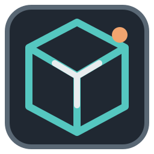

<p align="center">
  
</p>

<h1 align="center">IST_CADCraft</h1>

<p align="center"><b>2D CAD và vẽ kỹ thuật viết bằng Rust thuần — lõi CADCraft, giao diện và lệnh theo iStCAD.</b></p>

IST_CADCraft là bản Rust của iStCAD do iSt Solutions phát triển:

- **Lõi**: dựa trên [CADCraft](https://github.com/storytold/cadcraft) v0.21.0 (storytold/cadcraft@0d4b100, MIT OR Apache-2.0): engine lệnh, đọc/ghi DWG/DXF, render GPU/CPU, in PDF, LISP, MCP/CLI.
- **Giao diện, bố cục, lệnh**: theo iStCAD (`iStCAD_1`, WPF): title bar có logo, Undo/Redo, New/Open/Save/Save As, menu File/Edit/View và ô tìm lệnh; toolbar có Text Style / Dim Style / Layer kèm các công cụ vẽ; tab bản vẽ; thanh trái tự ẩn chứa 20 lệnh dùng nhiều nhất; Properties (Ctrl+1); dock dưới cùng có Model/Layout, PDF, OSNAP/ORTHO/POLAR/OTRACK/DYN, zoom và GRID.

Xem [docs/ISTCAD.md](docs/ISTCAD.md) để biết cách ánh xạ từng phần của iStCAD sang IST_CADCraft.

## Build và chạy

Cần Rust stable (≥ 1.95).

```bash
cargo run --release -p cadcraft              # mở ứng dụng
cargo run --release -p cadcraft -- --sample  # mở bản vẽ mẫu
```

Linux cần thêm các gói: `pkg-config libxkbcommon-dev libwayland-dev libx11-dev libxcb1-dev libxcursor-dev libxrandr-dev libxi-dev libfontconfig1-dev libfreetype-dev libgl1-mesa-dev libgtk-3-dev`.

### Visual Studio (Professional / Community / Enterprise)

1. Cài **Visual Studio 2022 trở lên** với workload **Desktop development with C++** (cung cấp trình liên kết MSVC mà Rust cần trên Windows).
2. Cài **Rust** từ https://rustup.rs (chọn toolchain mặc định `stable-x86_64-pc-windows-msvc`). Mở lại Visual Studio sau khi cài, để `cargo` có trong PATH.
3. Mở **`IST_CADCraft.sln`** ở thư mục gốc. Chọn cấu hình `Debug|x64` hoặc `Release|x64`.
4. **Build** (Ctrl+Shift+B) sẽ gọi `cargo build -p cadcraft`. **F5** chạy `target\<cấu hình>\IST_Cadcraft.exe` dưới debugger của Visual Studio; mở file `.rs` (trong Solution Explorer) để đặt breakpoint.
5. Lần build đầu tải các thư viện Rust và biên dịch toàn bộ, mất khoảng 5–15 phút; các lần sau nhanh hơn nhiều. Bản `Debug` chạy chậm hơn hẳn `Release` khi vẽ bản vẽ lớn.

Để chạy với bản vẽ mẫu: Project ▸ Properties ▸ Debugging ▸ Command Arguments = `--sample`.

### VS Code

Mở thư mục gốc, cài các extension được gợi ý (rust-analyzer, CodeLLDB / C++). `Ctrl+Shift+B` để build, F5 để chạy với debugger (cấu hình trong `.vscode/`).

CI (`.github/workflows/ci.yml`) chạy `cargo check`, test lệnh của engine và test của shell iStCAD trên Linux, sau đó build release cho Windows (tải `IST_Cadcraft.exe` ở mục Artifacts của mỗi lần chạy).

## Lệnh thường dùng (theo iStCAD)

| Lệnh | Alias | Ghi chú |
|---|---|---|
| LINE / PLINE | `L` / `PL` | Nhập điểm bằng chuột, `X,Y`, `@dX,dY`, `100<45` hoặc khoảng cách theo hướng con trỏ |
| CIRCLE | `C` | Tâm + bán kính |
| RECTANG | `REC` | Hai góc đối diện |
| ARC | `A` | |
| SELECT | `S` | Kéo trái→phải: chọn nằm trọn; phải→trái: chọn cắt qua |
| ERASE / MOVE / COPY | `E` / `M` / `CO` | Phím Delete cũng xóa |
| ZOOM Extents / Previous | `ZE` / `ZP` | Lăn chuột để zoom, giữ chuột giữa để pan |
| UNDO / REDO | `U` / `Y` | Ctrl+Z / Ctrl+Shift+Z |
| LAYOUT, PLOT, EXPORTPDF | `PDF` | Nút `+` và `PDF` ở dock dưới |
| REGEN, PERF | | `PERF` in số đối tượng và thời gian render |
| STRETCH | `STR` | (`S` dành cho SELECT như iStCAD) |

Toàn bộ lệnh của lõi CADCraft vẫn dùng được (xem Help ▸ Command Reference hoặc F1).

## Giấy phép và ghi công

Mã nguồn: MIT OR Apache-2.0 (xem `LICENSE-MIT`, `LICENSE-APACHE`, `NOTICE`, `ATTRIBUTION.md`).
IST_CADCraft dựa trên CADCraft của nhóm ArtCraft. Theo điều khoản thương hiệu của CADCraft, logo và
nhãn hiệu ArtCraft đã được gỡ khỏi bản này. IST_CADCraft không phải sản phẩm của ArtCraft, cũng không
được ArtCraft bảo trợ. README gốc của CADCraft được giữ ở
[docs/CADCRAFT-UPSTREAM-README.md](docs/CADCRAFT-UPSTREAM-README.md).
